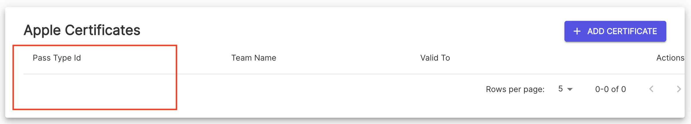

# PassKit Go Quickstart
[](https://opensource.org/licenses/MIT)
[](https://pkg.go.dev/github.com/PassKit/passkit-golang-grpc-sdk)

## Overview

Create and manage Apple Wallet and Google Wallet membership cards, coupons, event tickets, and boarding passes with the PassKit Go gRPC SDK.

The quickstart includes one-command product workflows, environment-based configuration, reusable pooled gRPC connections, and a shared typed API covering membership, coupons, event tickets, flights, templates, images, analytics, distribution, integrations, scanners, certificates, messages, and raw passes.

## Prerequisites

You will need the following:

- A PassKit account (signup for free at [PassKit](https://app.passkit.com))
- Your PassKit SDK Credentials (available from the [Developer Tools Page](https://app.passkit.com/app/account/developer-tools))
- Apple wallet certificate id (for flights only, available from the [certificate page](https://app.passkit.com/app/account/certificates))
 
- [Go 1.25 or newer](https://go.dev/dl/), as required by PassKit SDK `v1.1.163`

## Setup

1. Copy the environment template: `cp .env.example .env`.
2. Put `certificate.pem`, `key.pem`, and `ca-chain.pem` in `certs/`.
3. If your `key.pem` is encrypted, create a decrypted local copy using the password selected when the credentials were generated. Never commit either key.
4. Set `PASSKIT_EMAIL` in `.env`. For flights, also set `PASSKIT_APPLE_CERTIFICATE_ID`.
5. US accounts should set `PASSKIT_GRPC_HOST=grpc.pub2.passkit.io`; European accounts use `grpc.pub1.passkit.io`.

The SDK is already declared in `go.mod`; do not use `go install` to add it. `.env`, PEM files, IDE files, binaries, and logs are excluded from Git.

## Run a complete workflow

```bash
go run . membership
go run . coupons
go run . event-tickets
go run . flights
```

Each command runs one product flow. The connection pool defaults to four channels and can be changed with `PASSKIT_POOL_SIZE`. Set `PASSKIT_CLEANUP_DELAY_SECONDS` if you want time to inspect issued passes before follow-up and cleanup operations run.

## Tests

```bash
go test ./...
go vet ./...
```

These checks do not call the live PassKit API or require credentials.

## Shared API

`internal/passkit.API` exposes product-oriented typed clients for loyalty, coupons, event tickets, flights, templates, images, analytics, distribution, integrations, scanners, certificates, messages, and raw passes. Bulk membership, coupon, and ticket operations require explicit construction with `allowDestructive` enabled.

The quickstart uses the public PassKit Go SDK `v1.1.163`, downloaded through Go modules. No vendored SDK, local module replacement, or descriptor patch is required. Startup and protobuf map serialization are covered by the quickstart checks.

The SDK's optional `helpers/router` package still contains a syntax error in this release, so connections use the quickstart's local mTLS helper in `examples/shared/tls_connection.go`.


## What each workflow demonstrates

- **Membership:** create a program and tier; enrol, retrieve, list, count, email, update, credit, debit, and delete a member.
- **Coupons:** create a campaign and offer; issue, retrieve, list, count, update, redeem, void, and delete a coupon offer.
- **Event tickets:** create a template, production, venue, ticket type, and event; issue, validate, and redeem a ticket.
- **Flights:** create a template, carrier, airports, flight, and flight designator; issue a boarding pass, then demonstrate flight-resource cleanup.

The examples intentionally use generated identifiers and future dates. They do not contain account-specific PassKit IDs. Open the relevant file under `examples/` to run or adapt an individual operation.

## Documentation

- [Membership documentation](https://docs.passkit.io/protocols/member)
- [Coupon documentation](https://docs.passkit.io/protocols/coupon)
- [Boarding-pass documentation](https://docs.passkit.io/protocols/boarding)
- [Event-ticket documentation](https://docs.passkit.io/protocols/event-tickets/)


## Getting Help

- [PassKit Help Centre](https://help.passkit.com/)
- [PassKit support](https://passkit.com/)

## License

Distributed under the MIT License. See [LICENSE](LICENSE).
